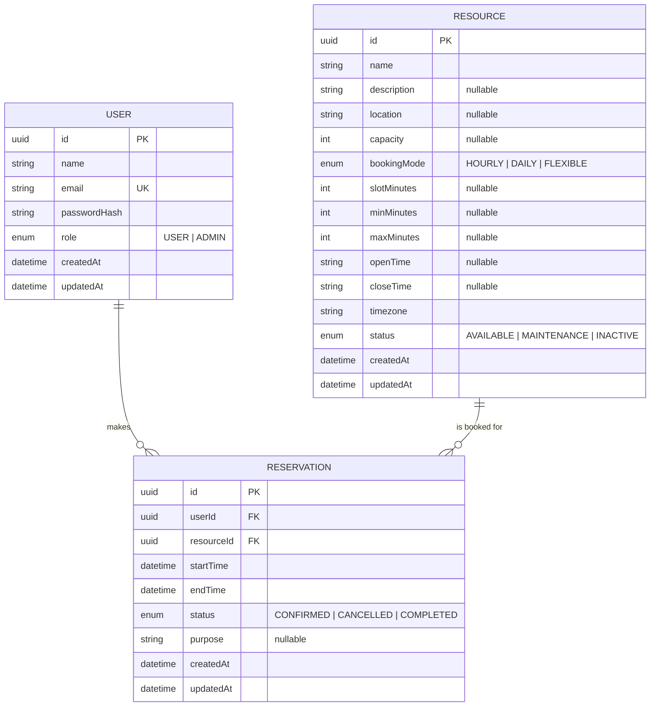

# PrimeWave Reservations

A centralized web application for managing shared facilities and equipment and
coordinating reservations across an organization.

Built with **Next.js (App Router) + TypeScript + PostgreSQL + Prisma**.

---

## The problem

Shared resources — meeting rooms, vehicles, equipment, event halls — were being
coordinated through informal messages and manual records. This led to:

- Overlapping reservations
- Uncertainty about what was actually free
- No reliable history of usage
- No single source of truth

This app replaces that with a single booking system that:

- Lists every resource and its booking rules
- Shows availability at a glance
- **Prevents double-bookings by construction** — enforced in the database, not
  just the UI
- Keeps a full audit trail of confirmations and cancellations

---

## Feature highlights

**For users**

- Browse and search resources with filters by booking mode
- See a month-view availability calendar with free / partial / full days
- Book hourly, daily, or flexible resources through a purpose-built picker
- View upcoming, past, and cancelled reservations
- Cancel their own future reservations

**For admins**

- Create, edit, deactivate resources
- Configure per-resource booking rules (slot size, min/max duration, opening
  hours, booking mode)
- View all reservations across the organization with filters and pagination
- Cancel any future reservation
- See the list of registered users

**Cross-cutting**

- JWT auth in an httpOnly cookie (works in middleware + server actions)
- Light and dark theme with no flash on load
- Toast feedback for every action
- Loading states everywhere
- Consistent error handling with a stable shape

---

## Tech stack

| Layer | Choice |
|---|---|
| Framework | Next.js 16 (App Router, Server Components, Server Actions) |
| Language | TypeScript |
| Database | PostgreSQL |
| ORM | Prisma 7 (`prisma-client` generator + `@prisma/adapter-pg`) |
| Auth | JWT (HS256 via `jose`) in an httpOnly cookie |
| Password hashing | bcryptjs |
| Styling | Tailwind CSS v4 (no component libraries) |
| Icons | lucide-react |
| Toasts | react-toastify |
| Calendar | react-day-picker |
| Validation | zod |
| Date utilities | Native `Intl` + a small `lib/time.ts` helper |

---

## Local setup

### 1. Prerequisites

- Node.js **20 LTS or newer**
- A running PostgreSQL 14+ instance (local or Supabase)
- `psql` recommended for verification

### 2. Clone and install

```bash
git clone <your-repo-url>
cd primewave-reservations
npm install
```

### 3. Configure environment

```bash
cp .env.example .env
cp .env.example .env.local
```

Fill in **both** files:

- `DATABASE_URL` — a Postgres connection string
- `JWT_SECRET` — a 64-character hex string (generate below)

```bash
node -e "console.log(require('crypto').randomBytes(32).toString('hex'))"
```

### 4. Create the database

```bash
createdb primewave   # or use an existing DB
```

### 5. Run migrations

The second migration adds a Postgres `EXCLUDE USING gist` constraint that
prevents overlapping confirmed reservations at the database level. It requires
`btree_gist` (part of `postgresql-contrib`; available by default on Supabase).

```bash
npx prisma migrate dev
```

### 6. Seed demo data

```bash
npm run db:seed
```

Creates 10 regular users, 1 admin, 6 resources, and ~9 reservations.

### 7. Run

```bash
npm run dev
```

Open http://localhost:3000.

---

## Demo credentials

All regular users share the same password. The login and register pages have
**autofill buttons** so you don't need to type them.

| Role | Email | Password |
|---|---|---|
| Admin | `admin@example.com` | `Admin123!` |
| User | `alice@example.com` | `Password123!` |
| User | `bob@example.com` | `Password123!` |
| User | `carol@example.com` | `Password123!` |
| ... | `dave@` … `judy@example.com` | `Password123!` |

---

## How the booking rules work

Every reservation is stored as a precise time range (`startTime`, `endTime`).
**One table serves hourly, daily, and flexible bookings** — only the validation
rules differ, driven by the resource.

| Mode | Example | Rules |
|---|---|---|
| `HOURLY` | Meeting room | Must start on a slot boundary, fit within open hours, respect min/max duration |
| `DAILY` | Company van | Must cover whole days; min/max in days |
| `FLEXIBLE` | Projector | Any start/end within min/max |

### Preventing overlaps — the core engineering decision

Every resource is a timeline. Two ranges overlap iff:

```
existing.start < new.end   AND   existing.end > new.start
```

Using **half-open intervals** `[start, end)` means adjacent bookings
(10:00–11:00 and 11:00–12:00) do not collide, but any true overlap does.

This is enforced at **two layers**:

1. **Application** — a `findFirst` inside a `Serializable` transaction
   provides clean, human-readable error messages.
2. **Database** — a Postgres exclusion constraint on `(resourceId, tsrange(startTime, endTime))`
   where `status = 'CONFIRMED'` is the source of truth under concurrency.

The database constraint is what makes the app race-condition-safe: two
simultaneous requests can never both succeed, even if they slip past the
app-level check.

---

## Data model



**Key database objects**

- Index: `Reservation(resourceId, status, startTime, endTime)` — speeds up the overlap query.
- Index: `Reservation(userId, startTime)` — speeds up "my reservations".
- Extension: `btree_gist` — required for the exclusion constraint.
- Constraint: `Reservation_no_overlap_confirmed` — the double-booking guarantee.

---

## API surface

Reads go through server components and Prisma directly. Mutations go through
server actions. Only one HTTP endpoint exists.

| Method | Path | Purpose |
|---|---|---|
| `GET` | `/api/resources/[id]/availability?from=&to=` | Returns busy intervals for the calendar |

Everything else is either a server component (reads) or a server action
(writes) — no `/api/*` boilerplate for operations that don't need it.

---

## Project structure

```
app/
├── (app)/                     # authenticated shell
│   ├── dashboard/             # summary + next 3 reservations
│   ├── reservations/          # my reservations
│   ├── resources/             # browse + detail with calendar
│   └── admin/                 # admin landing, resources, reservations, users
├── (auth)/                    # public shell
│   ├── login/                 # login + autofill buttons
│   └── register/              # register + 10 autofill buttons
├── api/resources/[id]/availability/
├── layout.tsx                 # theme script, providers
├── error.tsx                  # global error boundary
└── not-found.tsx              # custom 404

components/
├── availability/              # BookingPanel, AvailabilityCalendar, HourlySlotPicker
├── layout/                    # AppNav, NavLinks, UserMenu, MobileNav
├── reservations/              # BookingForm, ReservationCard, CancelReservationButton
├── resources/                 # ResourceCard, ResourceForm, ResourceBadges
└── ui/                        # Button, Card, Input, Badge, EmptyState, PageHeader, Pagination

lib/
├── actions/                   # server actions (auth, resources, reservations)
├── validators/                # zod schemas
├── generated/prisma/          # generated Prisma client
├── jwt.ts                     # sign + verify (Edge-compatible, jose)
├── password.ts                # bcrypt
├── session.ts                 # cookie helpers + requireUser/requireAdmin
├── prisma.ts                  # client + adapter
└── time.ts                    # timezone helpers

prisma/
├── schema.prisma
├── migrations/                # includes the btree_gist exclusion constraint
└── seed.ts
```

---

## Scripts

| Command | What it does |
|---|---|
| `npm run dev` | Start dev server |
| `npm run build` | Production build |
| `npm run start` | Start production server |
| `npm run lint` | ESLint |
| `npm run db:generate` | Regenerate Prisma client |
| `npm run db:migrate` | `prisma migrate dev` |
| `npm run db:studio` | Open Prisma Studio |
| `npm run db:seed` | Seed demo data |

---

## Console logging

The application logs every server action as `[module] action:phase`, e.g.:

```
[auth] login:start
[auth] login:success <userId>
[reservation] create:start
[reservation] create:conflict Already booked ...
```

This is intentional instrumentation for development and demonstration. In a
production deployment these would be routed to a structured logger (Pino,
Winston) and scoped to `NODE_ENV !== "production"`.

---

## Engineering decisions worth noting

- **Intervals, not slots.** Reservations are stored as precise `[start, end)`
  ranges. This makes 1-hour and 5-day bookings the same shape, keeps the overlap
  query a single indexed predicate, and avoids fragile slot grids.
- **Two-layer overlap prevention.** The app check gives good UX; the exclusion
  constraint guarantees correctness under concurrency.
- **Cancel, don't delete.** Reservations are cancelled (`status = CANCELLED`)
  rather than removed, so history is preserved. Cancelled rows are excluded from
  the overlap query.
- **Anonymous busy blocks.** On a resource's calendar, other users' bookings
  appear as anonymous busy intervals — users see what's free without seeing who
  booked what.
- **UTC storage, resource timezone display.** Instants are stored in UTC.
  Formatting happens in the resource's `timezone` (default `Asia/Colombo`).
- **Server-only reads.** Pages fetch data through Prisma directly — no
  internal `fetch()` calls to own API routes.
- **`force-dynamic` at the layout level.** Authenticated pages depend on
  cookies, so they must never be statically prerendered. Declared once in
  `app/(app)/layout.tsx`; children inherit it.

---

## Known limitations / future work

- **No resource images.** Deliberate scope choice.
- **No blackout periods.** A maintenance-window entity would use the same
  overlap predicate; skipped for v1.
- **No in-place edit.** Users cancel + re-create; admins use the same flow. This
  keeps the conflict path uniform.
- **Admin users list is read-only.** Promote/demote is a DB-level operation for
  now.
- **No password reset / email verification.** Out of scope for the assessment.
- **Completing reservations.** The `COMPLETED` status exists in the schema but
  is derived lazily from `endTime < now()` — no cron job. A scheduled transition
  would be the natural next step.# primawave
